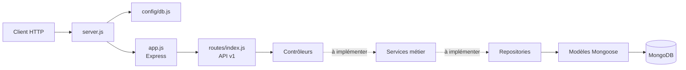

# Architecture de l'API ToolShare

## Vue d'ensemble

ToolShare est un backend REST en Node.js, Express 5, Mongoose et MongoDB.
L'architecture est initialisée dans `src/`. Les endpoints racine et santé
fonctionnent; les modules des ressources métier sont des points de départ et
ne fournissent pas encore de CRUD ni d'authentification.



## Structure du backend

```text
src/
  app.js
  server.js
  config/
    db.js
    swagger.js
  models/
    user.model.js
    store.model.js
    equipment.model.js
    reservation.model.js
    installation.model.js
  repositories/
    user.repository.js
    store.repository.js
    equipment.repository.js
    reservation.repository.js
    installation.repository.js
  services/
    auth.service.js
    installation.service.js
    store.service.js
    equipment.service.js
    reservation.service.js
  controllers/
    auth.controller.js
    installation.controller.js
    store.controller.js
    equipment.controller.js
    reservation.controller.js
    root.controller.js
    health.controller.js
  routes/
    index.js
    v1/index.js
    auth.routes.js
    installation.routes.js
    store.routes.js
    equipment.routes.js
    reservation.routes.js
  middlewares/
    auth.middleware.js
    role.middleware.js
    store-access.middleware.js
    validate.middleware.js
    error.middleware.js
  utils/
    jwt.util.js
tests/
  unit/
  integration/
```

Les fichiers métier marqués `TODO` ne sont pas des implémentations. Les schémas
de User, Store, Equipment et Reservation et leurs règles doivent être définis à
partir du modèle métier avant d'être activés. Le diagramme UML existant nomme
notamment l'entité `Tool`; il faut confirmer son équivalence avec `Equipment`.

## Requêtes HTTP disponibles

| Méthode | Chemin | Réponse |
| --- | --- | --- |
| `GET` | `/` | Message de bienvenue et environnement |
| `GET` | `/api/v1/health` | État `ok` et environnement |

Les routeurs `/api/v1/auth`, `/installation`, `/stores`, `/equipment` et
`/reservations` sont montés, mais ne définissent pas encore d'endpoints.

## Démarrage et configuration

`server.js` charge `.env`, attend la connexion MongoDB, puis démarre le serveur
HTTP. Une absence de `MONGO_URI` ou un échec de connexion empêche le démarrage
et est signalé dans la console.

| Variable | Usage |
| --- | --- |
| `PORT` | Port HTTP, `5000` par défaut. |
| `NODE_ENV` | Environnement retourné par les routes de base. |
| `MONGO_URI` | URI de connexion Mongoose. L'exemple Docker cible le service `mongodb`. |
| `JWT_SECRET` | Réservée à la future authentification; aucun JWT n'est actif. |

Ne créez pas de fichier `.env` contenant des secrets dans Git. Copiez
`.env.example` en `.env` localement. Démarrez les services avec :

```sh
docker compose -f docker-compose.yml up --build
```

`config/swagger.js` contient les métadonnées OpenAPI, mais l'interface Swagger
n'est pas encore servie par l'application.

## Responsabilités des couches

- **Routes** : associent les chemins HTTP aux handlers.
- **Middlewares** : validation, authentification, autorisation et erreurs.
- **Contrôleurs** : traduisent HTTP vers les appels applicatifs.
- **Services** : portent les règles métier et les orchestrations.
- **Repositories** : effectuent les requêtes Mongoose.
- **Models** : définissent les schémas persistés.

Les fonctionnalités métier doivent être ajoutées couche par couche, avec des
tests unitaires et d'intégration dans `tests/`.
